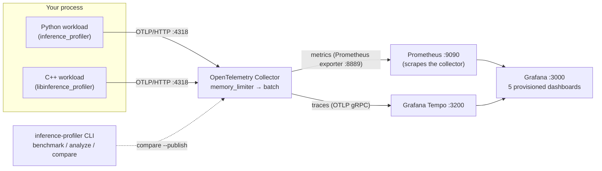

# Inference Performance Profiler

OpenTelemetry instrumentation, benchmarking and bottleneck analysis for LLM inference
workloads, with a Python SDK, a native C++ library, and a local Grafana / Prometheus /
Tempo stack.

It answers **"why is this inference workload slow?"** by breaking every request into
queue, prefill, time-to-first-token and generation phases, recording latency
distributions and throughput, flagging likely bottlenecks with stated thresholds, and
failing CI when a change makes benchmark results worse than a baseline.

Everything runs locally. You don't need a paid API, a cloud account, a GPU, a real
model or a hosted Grafana account. The bundled workload is a **deterministic simulator**.
This project does not claim to make any real LLM faster. It gives you the measurements
to find out.

> Status: alpha (0.1.0). The APIs may change before 1.0.

## Contents

- [Architecture](#architecture)
- [Features](#features)
- [Supported environments and prerequisites](#supported-environments-and-prerequisites)
- [Quick start (one command per step)](#quick-start)
- [Python SDK](#python-sdk)
- [C++ SDK](#c-sdk)
- [Local observability stack](#local-observability-stack)
- [CLI](#cli)
- [Benchmarks, reports and regression detection](#benchmarks-reports-and-regression-detection)
- [Integrating a real inference engine](#integrating-a-real-inference-engine)
- [Security and privacy](#security-and-privacy)
- [Overhead](#overhead)
- [Limitations and roadmap](#limitations-and-roadmap)
- [Troubleshooting](#troubleshooting)
- [Contributing](#contributing) · [License](#license)

## Architecture



The SDKs depend only on OpenTelemetry and the OTLP protocol. Your inference code never
talks to Grafana or Prometheus. Any OTLP-compatible backend works. See
[docs/architecture.md](docs/architecture.md).

## Features

- **Request-scoped instrumentation** (Python context managers / decorators, C++ RAII)
  with nested spans `inference.request` → `inference.queue`, `inference.prefill`,
  `inference.time_to_first_token`, `inference.generation`, `inference.cache_lookup`,
  `inference.cache_insert` and `inference.cache_evict`.
- **W3C trace-context propagation** in and out of a request (Python and C++).
- **Metrics with OTel names and units**: latency histograms (request, queue, prefill,
  TTFT, inter-token, generation, cache ops), per-request throughput, request/token
  counters, in-flight/active/queue-depth gauges, cache hits/misses/evictions, process
  RSS, clearly labelled *simulated* KV memory, and SDK health (export errors, dropped
  spans, instrumentation errors). See [docs/metrics.md](docs/metrics.md).
- **Safe by default**: no prompt or output text is accepted, metric labels are bounded
  by a cardinality limiter, request IDs only appear on spans, exporter failures never
  reach your code, and shutdown is bounded by a timeout.
- **Sampling** of traces (parent-based ratio) while metrics stay complete, plus an
  optional, capped per-token span mode for diagnostics.
- **Deterministic workload simulator**: arrival rate, concurrency, prompt and output
  length, queue delay, prefill cost, TTFT, inter-token delay, batching contention,
  prefix cache, KV-memory pressure, failures, cancellations, and injected regressions.
- **Benchmark runner** producing schema-validated JSON (percentiles from raw samples),
  **bottleneck analysis** with explained findings, a **regression checker** with a
  non-zero exit code, and **Markdown reports**.
- **Provisioned Grafana dashboards**: Overview, Latency Breakdown, Memory and Cache,
  Performance Regressions, Distributed Traces, plus exemplar and trace-to-metrics links.
- **CI**: lint/format/type checks, Python 3.11–3.13 tests, C++ builds on Linux and
  macOS, ASan/UBSan, clang-tidy, shellcheck, package build, deterministic regression
  checks, a Docker-based integration job, and a separate timing-sensitive workflow.

## Supported environments and prerequisites

| Component | Requirement |
|---|---|
| Python SDK / CLI | Python ≥ 3.11 (tested on 3.12; CI matrix 3.11–3.13), Linux/macOS/Windows |
| C++ library | C++17 compiler, CMake ≥ 3.25 (presets) / 3.20 (plain), Ninja recommended |
| C++ dependency | `opentelemetry-cpp` with the OTLP/HTTP exporter: Homebrew `opentelemetry-cpp` (tested with 1.29.0), vcpkg `opentelemetry-cpp[otlp-http]`, or `cmake --preset fetch`, which builds v1.29.0 from source and needs protobuf + libcurl development packages |
| Local stack | Docker with Compose v2 **or** native binaries via `scripts/native_stack.sh` |

Pinned stack images: `otel/opentelemetry-collector-contrib:0.161.0`,
`grafana/tempo:2.10.8`, `prom/prometheus:v3.13.4`, `grafana/grafana:12.4.12`.

## Quick start

From a fresh clone (macOS/Linux):

```bash
make setup        # .venv + pip install -e ".[dev]"; reports missing native deps
make build        # C++ library, native demo and tests (cmake --preset default)
make test         # Python (pytest) + C++ (CTest) unit tests
make lint         # ruff, ruff format --check, mypy --strict, dashboard freshness
make stack-up     # collector, Tempo, Prometheus, Grafana (Docker Compose) + health checks
make demo         # Python, C++ and CLI demos send telemetry to localhost:4318
make verify       # metrics in Prometheus, traces in Tempo, dashboards, integration tests
make benchmark    # benchmarks/results/latest.{json,md} (+ comparison if a baseline exists)
make stack-down
```

No Docker? Put `otelcol-contrib`, `prometheus`, `tempo` and an unpacked Grafana release
in a directory and run `BIN_DIR=/path make native-stack-up` instead of `make stack-up`
(`make native-stack-down` to stop). This uses the same configuration files.

Manual Python setup:

```bash
python -m venv .venv
source .venv/bin/activate                 # Windows PowerShell: .venv\Scripts\Activate.ps1
python -m pip install --upgrade pip
python -m pip install -e ".[dev]"
python -m inference_profiler.cli --help   # or: inference-profiler --help
```

On Windows, the Python SDK and CLI work natively. For the C++ library use Visual Studio
2022 with vcpkg (`vcpkg install opentelemetry-cpp[otlp-http]`) and configure with
`-DCMAKE_TOOLCHAIN_FILE=<vcpkg>/scripts/buildsystems/vcpkg.cmake`. The shell scripts
need Git Bash or WSL. Windows has not been tested by the maintainers.

## Python SDK

```python
from inference_profiler import Profiler, ProfilerConfig

profiler = Profiler(
    ProfilerConfig.from_env(  # defaults < environment < these overrides
        service_name="demo-inference-server",
        otlp_endpoint="http://localhost:4318",
        runtime_version="engine-2.3.1",
    )
)

with profiler.inference_request(
    model="demo-model",
    request_id="request-123",  # span attribute only, never a metric label
    prompt_tokens=512,
    parent=incoming_http_headers,  # optional: continues a W3C traceparent
) as request:
    with request.queue():
        wait_for_batch_slot()
    with request.cache_lookup() as lookup:
        lookup.hit = prefix_cache.contains(key)
    with request.prefill():
        run_prefill()
    with request.generation():
        for token in decode():
            request.record_token()  # 1st call records TTFT; then inter-token latency
    request.record_generation(generated_tokens=128)

profiler.shutdown()  # bounded flush; also runs at interpreter exit
```

- An exception inside the block marks the request `error` (span status, `error.type`,
  `inference.requests{inference.status="error"}`) and is **re-raised unchanged**.
  `RequestCancelled` / `asyncio.CancelledError` mark it `cancelled`.
- Use `async with` in asyncio servers. Concurrent requests get separate contexts.
- From deep helpers, call `inference_profiler.current_request()`, or decorate them:
  `@profiler.phase("prefill")`. Wrap whole handlers with
  `@profiler.trace_request(model="...")`.
- If you already have timings, pass them in:
  `record_generation(n, time_to_first_token_ms=35.0, inter_token_latencies_ms=[...])`.
- `ProfilerConfig(enabled=False)` (or `INFERENCE_PROFILER_ENABLED=false`) turns every
  call into a no-op that costs about 1 µs per request.

Full API: [docs/instrumentation.md](docs/instrumentation.md). Runnable example:
[`examples/python_inference_demo.py`](examples/python_inference_demo.py).

### Configuration

| Variable | Default | Meaning |
|---|---|---|
| `OTEL_EXPORTER_OTLP_ENDPOINT` | `http://localhost:4318` | OTLP/HTTP base URL; `/v1/traces` and `/v1/metrics` are appended |
| `OTEL_SERVICE_NAME` | `inference-service` | `service.name` (becomes the Prometheus `job` label) |
| `INFERENCE_PROFILER_ENABLED` | `true` | Master switch (`OTEL_SDK_DISABLED=true` also disables) |
| `INFERENCE_PROFILER_SAMPLE_RATE` | `1.0` | Trace sampling ratio, parent-based. Metrics are never sampled |
| `INFERENCE_PROFILER_EXPORT_INTERVAL` | `5000` | Metric export interval (ms) |
| `INFERENCE_PROFILER_MEMORY_INTERVAL` | `5000` | Process RSS sampling interval (ms); `0` disables |
| `INFERENCE_PROFILER_EXPORT_TIMEOUT` / `_SHUTDOWN_TIMEOUT` | `10000` / `5000` | Export and shutdown deadlines (ms) |
| `INFERENCE_PROFILER_RUNTIME_VERSION`, `_ENVIRONMENT`, `_STRICT`, `_EXPORTER`, `_TOKEN_SPANS` | | See [docs/instrumentation.md](docs/instrumentation.md#configuration) |

Precedence: **explicit overrides passed to `ProfilerConfig.from_env(...)` > environment
variables > defaults**. Constructing `ProfilerConfig(...)` directly ignores the
environment. Invalid values raise `ConfigError` and name the offending variable.
Endpoints with embedded credentials are rejected. Pass headers through
`OTEL_EXPORTER_OTLP_HEADERS` instead. The C++ SDK reads the same variables.

## C++ SDK

```cpp
#include "inference_profiler/profiler.hpp"
namespace ip = inference_profiler;

auto profiler = ip::Profiler::Create(ip::ProfilerConfig::FromEnv());

void Handle(ip::Profiler& profiler, const Request& in) {
  ip::RequestOptions opts;
  opts.model = "demo-model";
  opts.prompt_tokens = in.prompt_tokens;
  opts.traceparent = in.headers.traceparent;        // optional
  auto request = profiler.StartRequest(opts);       // RAII: ends when it goes out of scope
  { auto queue = request.Queue(); WaitForSlot(); }
  { auto lookup = request.CacheLookup(); lookup.SetCacheHit(cache.Has(in.key)); }
  { auto prefill = request.Prefill(); RunPrefill(); }
  {
    auto generation = request.Generation();
    while (DecodeStep()) request.RecordToken();
  }
  request.RecordGeneration(tokens_generated);
}   // an exception propagating through here marks the request (and open phase) as error

profiler->Shutdown();   // also called by the destructor
```

Build and run the native demo:

```bash
make build                                      # or: cmake --preset default && cmake --build --preset default
./build/cpp_inference_demo --requests 40        # endpoint from OTEL_EXPORTER_OTLP_ENDPOINT or localhost:4318
./build/cpp_inference_demo --endpoint http://localhost:4318 --workers 8
ctest --preset default                          # 25 unit tests
```

Running outside Docker, the demo must reach the collector's **host** port
(`http://localhost:4318`). Inside the Compose network, use `http://otel-collector:4318`.
To consume the library from your own CMake project, `add_subdirectory()` this
repository and link `inference_profiler::inference_profiler`. See
[docs/integration-guide.md](docs/integration-guide.md).

## Local observability stack

```bash
make stack-up          # docker compose up -d + scripts/verify_stack.sh
make demo
make verify
```

| Service | URL (host) | Notes |
|---|---|---|
| Grafana | http://localhost:3000 | Folder **Inference Profiler**. Anonymous **Viewer** access is enabled. Admin login `admin` / `admin` (override with `GRAFANA_ADMIN_USER` / `GRAFANA_ADMIN_PASSWORD`) |
| Prometheus | http://localhost:9090 | Scrapes the collector at `otel-collector:8889` every 5 s, with exemplar storage enabled |
| Tempo API | http://localhost:3200 | Queried by Grafana. Tempo's OTLP receiver is internal only |
| Collector OTLP | gRPC `localhost:4317`, HTTP `localhost:4318` | SDK default is HTTP 4318 |
| Collector health | http://localhost:13133 | `curl -s localhost:13133` |
| Collector metrics exporter | http://localhost:8889/metrics | What Prometheus scrapes |

All ports are bound to `127.0.0.1`. **The Grafana credentials and anonymous access are
for local development only. Never expose this stack on a reachable network.**

Health checks:

```bash
curl -s localhost:13133                       # collector
curl -s localhost:9090/-/ready                # prometheus
curl -s localhost:3200/ready                  # tempo
curl -s localhost:3000/api/health             # grafana
scripts/verify_stack.sh --telemetry           # all of the above + data from both demos
```

Dashboards (source of truth: [`scripts/generate_dashboards.py`](scripts/generate_dashboards.py)):

1. **Inference Overview**: request rate, error ratio, p50/p95/p99 latency (with exemplars), token throughput, concurrency, SDK health.
2. **Latency Breakdown**: mean time per phase, percentiles for queue, prefill, TTFT, generation and inter-token latency, decode throughput, latency heatmap.
3. **Memory and Cache**: real process RSS, *SIMULATED* KV memory and pressure (labelled as such), cache hits/misses/ratio, evictions, op latency, utilization.
4. **Performance Regressions**: baseline vs current table, % change, failed thresholds (from `compare --publish`), live p95 by runtime version.
5. **Distributed Traces**: Tempo TraceQL tables of recent, slow and failed requests and slow prefill phases.

## CLI

```text
inference-profiler doctor                     # versions, effective config, collector reachability
inference-profiler demo [--requests N] [--endpoint URL] [--no-export] [--output FILE]
inference-profiler benchmark --scenario examples/benchmark_scenarios.yaml \
    [--name SCENARIO ...] [--clock virtual|wall] [--output benchmarks/results/latest.json] \
    [--inject prefill_multiplier=1.5] [--runtime-version V] [--requests N] [--overhead]
inference-profiler analyze --input benchmarks/results/latest.json [--json] [--fail-on warning]
inference-profiler analyze --prometheus-url http://localhost:9090 --window 15m [--service NAME]
inference-profiler compare --baseline benchmarks/baseline.json \
    --current benchmarks/results/latest.json [--threshold latency_pct=5] [--output cmp.json] [--publish]
inference-profiler export-report --input benchmarks/results/latest.json \
    --output benchmarks/results/report.md [--baseline benchmarks/baseline.json]
inference-profiler validate --input FILE
inference-profiler overhead [--iterations 5000] [--output FILE]
```

Exit codes: `0` success, `1` failed check (regression, or a finding at `--fail-on`
severity), `2` invalid input or usage.

## Benchmarks, reports and regression detection

`--clock virtual` (the default) runs a deterministic discrete-event model with no
sleeping and no timing noise. Use it for correctness checks in CI. `--clock wall`
executes the same plan with real `asyncio.sleep` calls through the SDK and exports real
telemetry. Its latencies are wall-clock measurements of a **synthetic** workload. Every
report records which mode produced it and labels all simulated cache and memory values.

```bash
make baseline                     # benchmarks/baseline.json from a local virtual-clock run
make benchmark                    # latest.json, latest.md, latest.comparison.json
```

[`benchmarks/baseline.example.json`](benchmarks/baseline.example.json) only illustrates
the schema. It is marked `"example": true` and is **not** a measurement. Generate your
own baseline. The JSON schema is in
[`src/inference_profiler/schemas/benchmark-report.schema.json`](src/inference_profiler/schemas/benchmark-report.schema.json).

Excerpt of a generated report (virtual clock, `baseline` scenario, this repository's
defaults):

| Phase | count | p50 ms | p95 ms | p99 ms |
|---|---:|---:|---:|---:|
| End-to-end | 200 | 524.52 | 731.25 | 801.23 |
| Queue | 200 | 1.07 | 1.79 | 1.98 |
| Prefill | 200 | 7.84 | 29.57 | 34.62 |
| TTFT | 200 | 11.22 | 33.29 | 38.52 |
| Inter-token | 12639 | 8.09 | 10.30 | 11.24 |

Analysis of the bundled scenarios flags, for example:

```text
[CRITICAL] congestion: Requests spend a large share of latency waiting in the queue
           observed:  queue p50 3595.4 ms = 89% of end-to-end p50 4021.2 ms
           threshold: warning >= 25%, critical >= 50%
[WARNING ] sweep-c16: Throughput saturates between concurrency 4 and 16
           observed:  token throughput 316 -> 385 tok/s (+10% per doubling) while p95 latency 1099 -> 3292 ms (+73% per doubling)
```

Regression detection with a deliberately injected 1.5× prefill slowdown:

```bash
inference-profiler benchmark --scenario examples/benchmark_scenarios.yaml --name baseline --output base.json
inference-profiler benchmark --scenario examples/benchmark_scenarios.yaml --name baseline \
    --inject prefill_multiplier=1.5 --runtime-version sim-1.1 --output current.json
inference-profiler compare --baseline base.json --current current.json; echo "exit=$?"
```

```text
  REGRESSION   baseline  latency_ms.prefill.p95   29.57 -> 44.35 (50.00%, threshold 10% and > 0.5 ms)
  ...
6 regression(s), 0 improvement(s), 17 unchanged
RESULT: FAIL
exit=1
```

Thresholds: `latency_pct` (10), `throughput_pct` (10), `memory_pct` (15),
`error_rate_abs` (0.01), `cache_hit_ratio_abs` (0.05), `min_latency_delta_ms` (0.5 ms
noise floor), plus per-metric overrides such as `--threshold latency_ms.queue.p99=50`.
See [docs/benchmarking.md](docs/benchmarking.md).

## Integrating a real inference engine

Wrap the engine's request handler in a request scope, put phase scopes around the
scheduler wait, prompt processing and decode loop, and call `record_token()` per
streamed token. Report cache utilization with `profiler.set_cache_utilization()` if
the engine exposes it. The guide covers vLLM-style schedulers, C++ engines, mixed
Python/C++ processes (one SDK per span, no duplicate global providers), and
propagation across services: [docs/integration-guide.md](docs/integration-guide.md).

## Security and privacy

- Prompt text, generated text and tokens are never accepted by the API, so they cannot
  be exported. Don't put them into `attributes` yourself.
- Request IDs are span attributes only. Metric labels are limited to model, runtime
  version, status, phase, cache operation and token type, and each label is capped at
  64 distinct values. Extra values collapse to `_other`.
- Endpoints with credentials in the URL are rejected. Use `OTEL_EXPORTER_OTLP_HEADERS`.
- The stack binds to localhost and uses development credentials. See [SECURITY.md](SECURITY.md).

## Overhead

Measured with `inference-profiler overhead` on the development machine (Apple M5,
10 CPUs, macOS 26.6.2, Python 3.12.3, OpenTelemetry SDK 1.45.1). One request has 3
phases and 32 tokens, run 5,000 times; the best of 5 runs is reported. Export cost is
excluded because the exporter discards spans:

| Mode | per request | added vs disabled |
|---|---:|---:|
| disabled | 1.29 µs | n/a |
| enabled, trace not sampled | 205.6 µs | +204.4 µs |
| enabled, trace sampled | 260.7 µs | +259.4 µs |
| `record_token()` inside the decode loop | 137 ns per token | n/a |

Most of the per-request cost is the OpenTelemetry Python SDK's per-measurement work. The
32 inter-token samples are buffered during decoding and recorded when the request ends,
so the decode loop only pays the per-token cost above. Run the command on your own
hardware before relying on these numbers. They are not a guarantee, and this project
does not claim zero overhead. The C++ SDK has not been benchmarked yet. See
[docs/design-decisions.md](docs/design-decisions.md#overhead).

## Limitations and roadmap

- The workload is simulated. Cache statistics and KV memory in reports and dashboards
  come from the simulator and are labelled as such. No real engine integration ships yet.
- Logs are not instrumented, so the collector has no logs pipeline.
- Dropped spans are counted only when an export fails. Drops from a full in-process
  span queue are logged by the OpenTelemetry SDK but not counted.
- The C++ SDK has no per-token span mode and does not sample RSS on a timer. RSS is read
  at metric export time.
- Prometheus-based analysis (`analyze --prometheus-url`) approximates distributions
  from histogram buckets and cannot see per-scenario configuration.
- Roadmap: vLLM / llama.cpp integration examples, a logs pipeline, an exponential
  histogram option, a C++ overhead benchmark, and alerting rules.

## Troubleshooting

`inference-profiler doctor` shows the effective configuration and whether the collector
is reachable. Common issues, such as no data in Grafana, `opentelemetry-cpp not found`,
port conflicts and Tempo volume permissions, are covered in
[docs/troubleshooting.md](docs/troubleshooting.md).

## Contributing

See [CONTRIBUTING.md](CONTRIBUTING.md) and the [Code of Conduct](CODE_OF_CONDUCT.md).
Run `make lint test` before opening a pull request. Report security issues as described
in [SECURITY.md](SECURITY.md).

## License

[Apache License 2.0](LICENSE).
