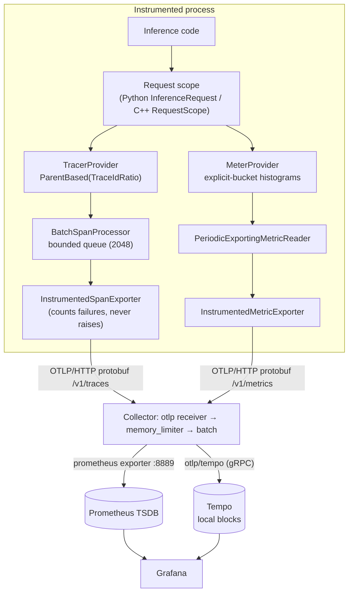

# Architecture

## Components

| Path | Responsibility |
|---|---|
| `src/inference_profiler/config.py` | Immutable, validated `ProfilerConfig`; env-var parsing and precedence |
| `src/inference_profiler/instrumentation.py` | `Profiler`, request and phase scopes, exporter wrappers, bounded shutdown |
| `src/inference_profiler/metrics.py` | Metric names, units, buckets, instrument set, cardinality limiter |
| `src/inference_profiler/context.py` | `current_request()`, W3C trace-context helpers |
| `src/inference_profiler/memory.py` | Real RSS sampling; the *simulated* KV-memory model |
| `src/inference_profiler/simulator.py` | Scenario config, deterministic plans, virtual and wall-clock execution |
| `src/inference_profiler/benchmark.py` | Benchmark runner, report schema, percentile maths, overhead benchmark |
| `src/inference_profiler/analysis.py` | Bottleneck rules over reports or live Prometheus data |
| `src/inference_profiler/regression.py` | Baseline comparison, thresholds, OTLP publication of results |
| `src/inference_profiler/reporting.py` | Markdown and terminal rendering |
| `src/inference_profiler/cli.py` | `inference-profiler` command |
| `cpp/include/inference_profiler/*.hpp` | Public C++ API (`profiler.hpp`, `span.hpp`, `config.hpp`, `metrics.hpp`, `testing.hpp`) |
| `cpp/src/*.cpp` | C++ implementation on the OpenTelemetry C++ SDK |
| `monitoring/` | Collector, Prometheus, Tempo and Grafana configuration |

## Request data flow

1. `inference_request()` / `StartRequest()` starts the `inference.request` span (kind
   SERVER). It continues the trace from a W3C `traceparent` header when you pass one,
   and increments `inference.requests.in_flight` and `inference.requests.active`.
2. Each phase scope starts a child span with an explicit parent, so phases opened on
   other threads or asyncio tasks still nest correctly. A `queue` phase moves the
   request from *active* to *queue depth* until it ends.
3. The first token records the `inference.time_to_first_token` span and histogram.
   That span has explicit timestamps: it starts with the request and ends at the first
   token. Later tokens produce inter-token-latency samples.
4. Ending the request sets the status, records `inference.request.duration` and
   `inference.requests{status}`, and decrements the gauges. Exemplars link the
   histogram sample to the trace when the trace is sampled.
5. Spans are batched and exported asynchronously. Metrics are exported every
   `export_interval_ms` with cumulative temporality, which the collector's Prometheus
   exporter requires.

## Separation from backends

The SDKs emit OTLP only. Swapping Tempo for Jaeger, or Prometheus for Mimir, only
changes collector configuration. Applications never import Grafana or Prometheus
clients.

## Telemetry naming in Prometheus

The collector's Prometheus exporter translates names: dots become underscores, units
become suffixes (`s` → `_seconds`, `By` → `_bytes`, `1` → `_ratio`, `{token}/s` →
`_per_second`, `%` → `_percent`), and monotonic counters gain `_total`. The OTel
`service.name` becomes the `job` label. `tests/python/test_dashboards.py` checks every
dashboard query against these rules, and `scripts/check_dashboard_queries.py` checks
them against a live Prometheus.
